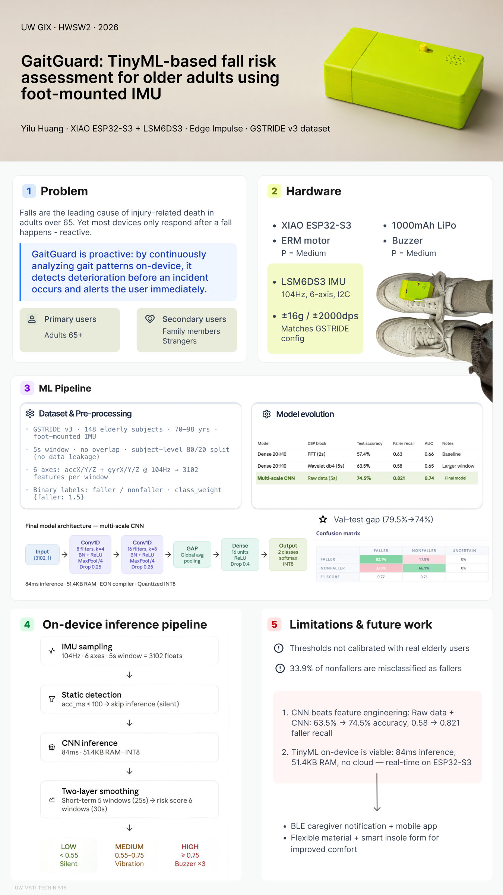

# GaitGuard (Individual Project Deliverables)

This repository contains the main deliverables for a prototype **wearable fall-risk detection / alerting** project: enclosure hardware design, on-device inference firmware, and an ML data preprocessing + Edge Impulse training workflow based on the GSTRIDE dataset.

> Designed for review: start from the architecture below, then jump to each deliverable folder.

---

## Poster

[](docs/HWSW2-poster.pdf)

Click the image to open the full-resolution PDF: [`docs/HWSW2-poster.pdf`](docs/HWSW2-poster.pdf)

---

## Architecture (end-to-end)

The system consists of two major parts: an **offline ML pipeline** (data → model) and an **on-device runtime** (sensor → inference → feedback).

```mermaid
flowchart LR
  subgraph Offline["Offline (ML)"]
    A["GSTRIDE v3 dataset<br/>IMU CSV + labels Excel"] --> B["Preprocess & windowing<br/>`ml/preprocess_gstride.py`"]
    B --> C["Edge Impulse dataset<br/>`ml/ei_dataset_5s/{training,testing}`"]
    C --> D["Edge Impulse training<br/>(DSP features + classifier)"]
    D --> E["Export inference library<br/>`firmware/lib/a5s-Gaitgaurd_inferencing/`"]
  end

  subgraph Device["Device (Firmware)"]
    S["LSM6DS3 IMU (6-axis)"] --> M["ESP32-S3 firmware<br/>`firmware/src/main.cpp`"]
    M --> I["Window buffer @ `EI_CLASSIFIER_FREQUENCY`<br/>→ `run_classifier(...)`"]
    I --> P["`P(faller)` + smoothing"]
    P --> F["Feedback policy<br/>silent / vibration / buzzer"]
  end

  E --> M
```

---

## Deliverables map (annotated tree)

```
GaitGuard/
├── README.md                          ← Repository front page (this file)
├── docs/                              ← Demo assets
│   ├── demo_video.mov                 ← Demo video (large file; may be git-ignored)
│   ├── HWSW2-poster.pdf               ← Project poster
│   └── HWSW2-poster.jpg               ← Poster preview image (shown in this README)
├── hardware/                          ← Enclosure / hardware documentation
│   ├── Gaitgaurd.pdf                  ← Hardware document (notes/drawings/figures)
│   ├── front layer.png                ← Layer diagram (front)
│   ├── back layer.png                 ← Layer diagram (back)
│   ├── printed enclosure.JPG          ← Photo of the printed enclosure
│   └── enclosure/                     ← 3D printable files
│       ├── 底部.stl
│       ├── 盖子.stl
│       └── 扁嘴夹.3mf
├── firmware/                          ← ESP32-S3 firmware (PlatformIO)
│   ├── platformio.ini                 ← Board/framework/serial settings
│   ├── src/
│   │   └── main.cpp                   ← Main firmware: IMU → inference → feedback
│   └── lib/
│       └── a5s-Gaitgaurd_inferencing/ ← Edge Impulse exported inference library
├── ml/                                ← ML preprocessing + Edge Impulse dataset export
│   ├── README.md                      ← ML pipeline documentation
│   ├── preprocess_gstride.py          ← GSTRIDE → windowed CSVs for Edge Impulse
│   └── GSTRIDE_DDBB.xlsx              ← Labels Excel (input to preprocessing)
└── .gitignore                         ← Ignores OS artifacts and large datasets/videos
```

---

## Demo (`docs/`)

- `docs/demo_video.mov`: project demo video (large file).
- `docs/HWSW2-poster.pdf`: project poster.

---

## Firmware (`firmware/`)

Goal: read **LSM6DS3 6-axis IMU** data on a **Seeed XIAO ESP32S3**, buffer samples at `EI_CLASSIFIER_FREQUENCY`, run inference, then map `P(faller)` to alert policies (silent / vibration / buzzer).

### Key files

- `firmware/platformio.ini`: PlatformIO project config (board, framework, serial baud rate, etc.).
- `firmware/src/main.cpp`: main application
  - Reads IMU via I2C (acceleration in m/s², angular velocity in rad/s)
  - Sampling frequency is `EI_CLASSIFIER_FREQUENCY`
  - Runs `run_classifier(...)` whenever a full window is collected
  - Applies a sliding average over the latest 3 windows for the `faller` probability, then triggers different feedback policies
- `firmware/lib/a5s-Gaitgaurd_inferencing/`: Edge Impulse exported inference library (linked and used by `main.cpp`)

### Quick start (local development)

1. Install PlatformIO (VSCode or CLI).
2. Go to `firmware/`, build, and flash to the XIAO ESP32S3.
3. Open the serial monitor at `115200` (see `platformio.ini`). You should see:
   - Raw 6-axis debug output (about once per second)
   - `P(faller)` and the smoothed probability
   - Feedback level (LOW/MEDIUM/HIGH)

> Note: IMU full-scale settings and unit conversions are aligned in `firmware/src/main.cpp` to match the training data units. If you change the sensor or its range, adjust this section accordingly.

---

## ML (`ml/`)

Goal: preprocess **GSTRIDE v3** subject IMU CSVs + label Excel into per-window CSV files that can be uploaded to Edge Impulse (train/test split by subject to avoid leakage).

See `ml/README.md` for the full pipeline documentation and exact commands:
- Preprocessing: `python preprocess_gstride.py --dry-run` / `--write`
- Edge Impulse upload commands
- Parameter defaults (window/stride/split/trim)

---

## Hardware (`hardware/`)

Goal: provide enclosure/structure design assets and assembly references.

### Key files

- `hardware/Gaitgaurd.pdf`: hardware-related document (notes/drawings/figures).
- `hardware/front layer.png`, `hardware/back layer.png`: layered structure diagrams.
- `hardware/printed enclosure.JPG`: photo of the printed enclosure / assembly.
- `hardware/enclosure/`: 3D enclosure & clip files (`.stl` / `.3mf`, etc.).

---

## Notes (recommended cleanup before submission)

This repo may include `.DS_Store` files (generated by macOS Finder). If your submission rules disallow them, delete them before submitting.

Large artifacts are intentionally ignored in `.gitignore` (e.g., datasets and large videos) to keep the GitHub repo lightweight.

